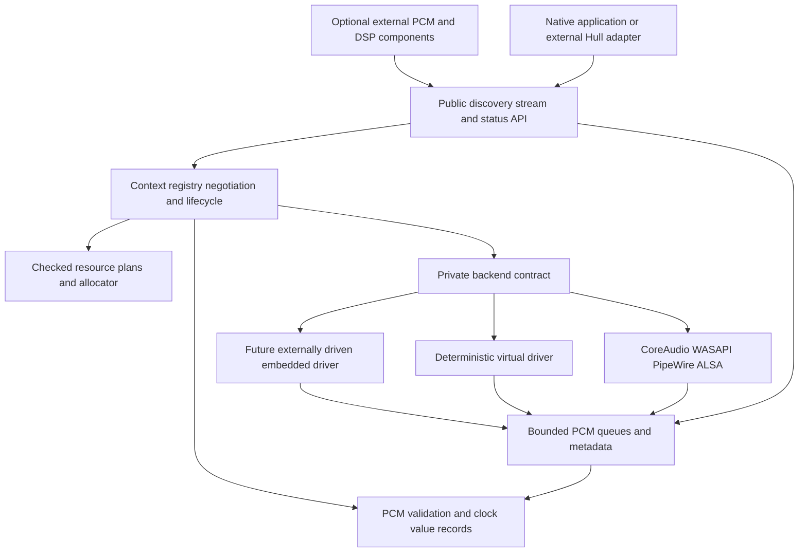

# Hail architecture proposal

Gate B architecture approved by the owner on 2026-11-15. Gate C implements the
portable/virtual core; Gate D now adds all four native adapters.
[Current API refinements](api.md), [native contracts](native-backends.md) and the
[execution-adapter boundary](backend-authoring.md) specify implemented scope.
The [audit](audit.md) grounds ecosystem and backend choices; this document
defines proposed Hail behavior. Numeric limits and signatures are reviewable
design choices, not a frozen ABI or shipped support claim.

## Scope and principal decisions

Hail transports timestamped PCM between native audio endpoints and application
threads. It provides explicit discovery, format negotiation, bounded capture and
playback, independent playback interruption, lifecycle completion and failure
observation. It does not schedule conversations or perform inference, speech
processing, codecs, persistence or networking.

1. Use an explicit context and opaque streams, without a public device handle.
2. Provide bounded copy-based read/write queues. No application audio callbacks
   in version 1; no portable claim of zero-copy.
3. Keep backend execution private: native callbacks/workers and externally
   driven virtual/embedded processing feed the same semantic core.
4. Keep requested application PCM exact. Optional, explicit native/server
   conversion is distinct from Hail processing; no Hail resampler in core.
5. Pin streams to resolved endpoints. Default changes notify; replacement
   requires explicit reopen. Do not migrate audio silently.
6. Use asynchronous start, stop, flush and close requests with queryable
   completion. Final destruction requires backend retirement and application
   quiescence. No application callbacks complicate public teardown.
7. Own native adapters, initially CoreAudio, shared WASAPI, PipeWire and ALSA,
   after the deterministic virtual implementation.

## Independent axes and dependency rules

Axes are responsibilities, not a demand for sixteen objects or vtables.

| Axis | Owner and invariant | Explicit exclusion | Independent verification or replacement |
| --- | --- | --- | --- |
| Platform | Backend owns native resources; only validated neutral descriptors cross the seam | Application policy and queue admission | Run same conformance scripts through each adapter |
| Discovery | Context registry copies bounded endpoint records and issues incarnation IDs | Permission grants or live format guarantee | Script endpoint add/remove/default changes |
| Capabilities | Query reports supported, unsupported or unknown features | Predicting successful access | Fake incomplete metadata and capability rejection |
| Negotiation | Open validates exact application PCM and reports endpoint format/conversion | Implicit DSP or device-global rate changes | Exhaust format combinations without a device |
| Direction | Each stream has optional capture and playback legs | Assuming equal periods, rates or clocks | Test simplex and unequal duplex legs |
| Representation | Value descriptions define samples, channels and frames | Memory allocation or OS PCM structures | Pure byte/size/format validation |
| Memory | Context budget and allocator own Hail storage | Bounding OS/server allocations | Fault allocator and fixed arena |
| Transport | Queue core owns bounded frame copies and metadata | Thread creation or native API calls | Ring wrap, partial I/O, capacity exhaustion |
| Execution | Backend driver serializes each leg's processing | Calling language runtimes or application callbacks | Inline/scripted/worker drivers against identical core |
| Timing | Leg clock records preserve position, domain, epoch and validity | Clock synchronization or drift correction | Rational virtual clocks and discontinuities |
| Lifecycle | Stream controller owns legal state changes and operation completion | Native cancellation assumptions | Enumerate transitions and late callbacks |
| Flow control | Capture drops newest; playback outputs silence; losses observable | Blocking a device to wait for consumers | Slow/fast producer scripts |
| Recovery | Terminal leg failure, explicit reopen | Automatic retries or default following | Remove/replace at every lifecycle boundary |
| Processing | Optional external companion consumes PCM and render reference | Device lifecycle ownership | Standalone conversion/DSP tests |
| Configuration | Immutable context/backend selection and stream limits | Process-wide mutable registry | Feature-excluded builds, independent contexts |
| Security | OS permission checks and validated quotas at open | Host sandbox policy or consent UI | Permission faults and malformed native descriptors |



Arrows mean permitted calls/dependencies. Backend callbacks may publish terminal
status through fixed mailboxes in the core, not call public control operations.
Queue/value modules include no OS, thread, Hull, Keel or DSP header. Lifecycle
knows private backend operations, never platform types. Native backends know
Hail semantics but not each other's headers. Allocation policy is supplied per
context; the selected adapter supplies clock facts tracked independently per
leg. No lower layer depends on an application runtime.

The private seam has validated discovery/probe/open/control/retire operations
and bounded capture/render entry points. The private backend explicitly declares
serialized or concurrent execution ownership independently of backend identity
and capabilities; it is not a public callback requirement. Adapter state and
variable scratch storage are planned through that private seam, rather than
embedded in the generic stream. Multiple native processing sources
must be serialized per leg before entering queue code. Cross-leg ordering is
not required. New backend operations cannot change portable queue semantics.

### Abstraction review

| Abstraction | Owns and excludes | Dependencies | Invariant, replacement and embedded fit |
| --- | --- | --- | --- |
| `ha_context` | Allocator/budget, backend instance, registry, clock namespace; excludes conversations and DSP | Value validation, memory provider, private backend | No global mutable configuration; independent contexts. Virtual context can use only caller arena and explicit drive calls. |
| Endpoint record and selector | Copied identity/capabilities; no open resources | Fixed value types | Enumeration index never acts as identity. Replace discovery without changing streams. No desktop manager required. |
| `ha_stream` | Two optional legs, queues and lifecycle; no physical-device ownership abstraction | Context, queues, backend contract | Fixed format until close; independently testable and backend-neutral. Embedded driver can call bounded entries. |
| PCM queue and block metadata | Storage, frame transfer and continuity; excludes scheduling | Integer/atomic portability seam | One producer and consumer, bounded copying, no reclamation while running. Can use static arena. |
| Clock record | Correlation facts/uncertainty; excludes resynchronization | Fixed-width values | Unknown stays unknown. Rational virtual provider substitutes without changing I/O API. |
| Backend contract | Native resources, notifications and physical retirement; excludes public ABI extension and policy | Core entry points, native services | Can replace per platform without rewriting transport. Embedded atomics/cache/DMA obligations remain explicit. |

No separately allocated `ha_device`, scheduler, clock object, generic executor,
graph, filter object or public backend-plugin registry is justified for version 1.
The context is justified by shared discovery/notifications, allocator and quotas,
backend session/COM ownership and clock namespace; it is not a hidden singleton.

## Public API shape

One installed `hail.h` contains the ordinary API. `hail/virtual.h` is justified
for deterministic driving and fault injection, and is optional at build time.
Backend-author headers stay private and version with source until a separate
extension ABI has evidence and review.

The following is a signature sketch. Complete structs, numeric codes, examples
and compilable headers belong to Gate C after review.

```c
typedef struct ha_context ha_context;
typedef struct ha_stream ha_stream;
typedef int32_t ha_result;

ha_result ha_context_create(const ha_context_config *, ha_context **out);
ha_result ha_context_refresh(ha_context *);
ha_result ha_context_enumerate(ha_context *, ha_device_info *items,
                               uint32_t capacity, uint32_t *count);
ha_result ha_context_poll(ha_context *, ha_event *items,
                          uint32_t capacity, uint32_t *count);
ha_result ha_context_destroy(ha_context **);

ha_result ha_device_probe(ha_context *, const ha_device_selector *,
                          const ha_format *, ha_probe_info *out);
ha_result ha_stream_open(ha_context *, const ha_stream_config *,
                         ha_stream **out);
ha_result ha_stream_get_info(ha_stream *, ha_stream_info *out);
ha_result ha_stream_start(ha_stream *);
ha_result ha_stream_stop(ha_stream *);
ha_result ha_stream_read(ha_stream *, void *dst, uint32_t frame_capacity,
                         uint32_t *frames, ha_block_info *out);
ha_result ha_stream_write(ha_stream *, const void *src, uint32_t frames,
                          uint64_t playback_generation, uint32_t *accepted);
ha_result ha_stream_flush_playback(ha_stream *, uint32_t flags,
                                   uint64_t *new_generation);
ha_result ha_stream_read_reference(ha_stream *, void *dst,
                                   uint32_t frame_capacity,
                                   uint32_t *frames, ha_block_info *out);
ha_result ha_stream_get_status(ha_stream *, ha_stream_status *out);
ha_result ha_stream_close_begin(ha_stream *);
ha_result ha_stream_close_finish(ha_stream **);
ha_result ha_get_version(ha_version_info *out);
const char *ha_result_string(ha_result);
```

`get_info` returns fixed negotiated settings; `get_status` returns a coherent
snapshot of lifecycle, terminal status, cumulative counters, playback generation
and last flush result. No generic unbounded property-bag interface. Feature
bits on version/context/device/stream distinguish compiled functionality from
live support. Unknown bits in output must be ignored; unsupported required
input bits fail explicitly. `device_probe` is advisory; open revalidates.

`ha_context_poll` is the control-thread progress point, with a configured work
budget per call. Backend workers can progress audio independently; portable
control completions become visible no later than a subsequent poll after their
mailbox is published. `refresh` may perform blocking native discovery on a
control thread; it is never called from poll's real-time path. A registry-dirty
event asks the application to refresh. No portable wait API or OS handle leaks.

### ABI evolution

Target ABI major 1 only after Gate C contract tests and platform compile checks.
Pre-1 releases are explicitly unstable. Version query returns semantic version,
ABI major/minor and feature bits. Shared objects use `SOVERSION=1` when frozen;
breaking changes require a new major/soname and new Windows DLL name.

Public input/output records begin with `uint32_t struct_size` and
`uint32_t struct_version`. Version 1's published field offsets are permanent
within ABI 1; optional fields append at the end. The library accepts only known
version/minimum-size combinations, reads the supplied known prefix, and treats
missing optional input fields as zero. New required semantics need a flag that
old libraries reject or a new function. Output writes at most the caller's
size, preserving the caller's size/version header; no tail clearing beyond that
size. Reject unknown struct versions. A newer caller can ask for version 1 with
its larger size; an older library ignores that tail, while feature discovery
prevents reliance on unsupported fields. Test both old-caller/new-library and
new-caller/old-library pairs.

Use fixed-width integer typedefs plus `HA_*` constants for public status,
format, flags and state values; no compiler-sized enum, `bool`, `long`, bitfield,
atomic, flexible array or platform structure in ABI records. No struct return
by value. Use pointers and fixed integer lengths across calls; allocation
callbacks may use `size_t` because they follow the target C data model. UTF-8
strings use fixed byte arrays plus length; truncation is flagged. A truncated
identity is unusable for selection, never silently aliased.

ABI compatibility is per target architecture, calling convention and normal
platform C data model, not across 32/64-bit processes or byte orders. Require
8-bit bytes, 16/32/64-bit integers and IEEE binary32 for float PCM. No packed
records or caller `#pragma pack`; target offset/size assertions and C/C++
consumer tests pin layouts. Public records of fixed scalars/arrays can cross
matching shared-library boundaries; pointer-bearing config/allocator records
are valid only in-process with matching target ABI and documented lifetimes.
They are never wire/serialization formats.

`HA_API` marks explicit imports/exports, `HA_CALL` is `__cdecl` on Windows for
functions and callbacks, and `extern "C"` guards declarations. Static consumers
define `HA_STATIC`. Shared builds default to hidden visibility and use exact
ELF version-script, Mach-O export list and Windows `.def` allowlists. Nonpublic
cross-translation-unit names use `hail_*`; file-local helpers are `static`.
Static global symbol inventory is checked independently of shared visibility.
No compiler's C++ types or exception mechanism enters the ABI.

### Ownership of every pointer category

| Pointer | Ownership, mutation and validity | Retention and concurrent access |
| --- | --- | --- |
| Context/stream outputs | Library-owned handles; returned only on successful construction; failure sets handle output NULL | Caller may retain until successful destruction; never copy ownership or use a stale alias |
| `ha_context **`, `ha_stream **` destruction arguments | Caller owns pointer slot; successful destruction NULLs it | Slot access is exclusive; NULL destruction is a no-op; stale alias double-close is invalid |
| Configs/selectors/formats | Caller owns immutable input during call; library copies known fields | Not retained, except explicitly identified allocator callbacks/user pointer below |
| Allocator functions/user state | Caller-owned, library copies function table | User state must outlive context destruction; calls occur on serialized control path, never audio path |
| Audio input to write | Caller owns, readable and unmodified during call; copied before return | Not retained; safe to reuse after return; accepted frames alone transfer into queue |
| Read/reference destination | Caller owns mutable buffer for stated frame capacity | Not retained; library writes only returned frames during call; application coordinates overlapping buffers |
| Output records/arrays/counts | Caller owns writable, properly aligned storage; valid size/version required | Not retained; caller exclusively accesses during call, then may copy/mutate results |
| Static result strings | Library owns immutable storage until unload | Never mutate/free; concurrent reads allowed; unknown codes return a static fallback |
| Backend borrowed native buffers | Native owner grants use only during processing entry or explicit native lease | Never escape to application; no release or reuse until native contract permits |

No general user callback or retained application audio pointer exists. All
nonzero-length buffers require non-NULL pointers; zero-frame read/write permits
NULL PCM storage and does no transfer. Mandatory output pointers remain non-NULL.
Lengths are checked before access. No overlapping source/destination/library
storage is allowed. Destruction retires all backend users but does not join
arbitrary application threads: application quiescence is a stated prerequisite.

## Devices and negotiation

Enumeration returns copied bounded records with direction bits, display name,
backend tag, runtime ID/incarnation, default roles and capability-validity bits.
The caller supplies array capacity. Insufficient space returns `HA_TOO_SMALL`
and required count without a partial list. Device registry capacity exhaustion
is explicit, not silent eviction. Refresh builds a new snapshot transactionally;
failure preserves the previous snapshot and marks it stale. Queries cannot
prove later access will succeed.

An index is valid only in that enumeration snapshot. Runtime IDs are
context-scoped, monotonically issued and never reused within a context; they
identify one endpoint incarnation. Persistent native keys are copied as optional
opaque bytes with backend/scope tags, not guaranteed globally permanent. A
selector names a runtime ID, a valid native persistent key, or a logical default
role (capture default / playback multimedia / playback communications).
Unsupported roles return `HA_UNSUPPORTED`, not an undocumented fallback.

Open resolves defaults once and records actual endpoint identities. Default
change produces an event but leaves the stream pinned if the old endpoint
remains usable. If a server cannot preserve pinning, migration is not silently
accepted: treat the change as loss and require reopen. Disconnecting either leg
terminates the whole duplex stream in version 1; playback flush alone never
does. Endpoint replacement is a new incarnation; reopen creates a new stream,
new timelines and empty queues. No automatic retry/backoff or recovery loop.

Version 1 application PCM: native-endian signed two's-complement S16 and IEEE
F32, interleaved, one or two channels. Mono layout means one mono channel;
stereo means ordered front-left/front-right. A frame contains one sample per
channel; bytes per frame are channels times bytes per sample. Explicit layout
and storage tags reserve room for future channel maps and planar formats;
version 1 rejects them. F32 nominal range is [-1,1]; the application supplies
finite samples in range, with no core clipping, dither or normalization.

Requested rates include 16000, 24000, 44100 and 48000 Hz; integer rates in
8000..192000 are representable under proposed hard limits. A native endpoint
need not support all of them. Capture and playback requests may differ. Open
returns per leg: requested format, actual application format, native endpoint
format if known, native engine format if known, period bounds, capacity, clock
facts, and conversion location/flags (`NONE`, `NATIVE`, `SERVER`, `UNKNOWN`).
Unknown physical format is explicitly invalid, not filled with the app format.

Two negotiation modes suffice:

- **Exact end-to-end:** no Hail conversion; native/server conversion must be
  disabled and absence verifiable. Reject `HA_UNSUPPORTED` if the backend cannot
  establish that, or `HA_FORMAT_UNSUPPORTED` if it can establish a mismatch.
- **Exact application:** no Hail conversion; caller permits native/server format
  adaptation, explicitly reported even when physical details are unknown. The
  application-facing request still cannot change silently.

Format fallback means close/open with another explicit request, optionally after
probe. Version 1 never changes device-global sample rate, takes exclusive access
or manufactures an aggregate device implicitly. Runtime renegotiation that
would exceed reserved buffers or alter application PCM terminates the stream
with an event; it does not allocate or reconfigure on the audio thread.

## Bounded memory and audio delivery

Each enabled leg has `N` fixed slots, each carrying up to `Q` frames and one
metadata record. `Q` is the validated maximum native processing quantum; it is
not an assertion that capture/playback callback lengths match. Oversized native
input is rejected/fails safely; a backend that can receive variable buffers
must negotiate a safe maximum or explicitly split within an established bound.
Playback can consume partial slots. Reads stop at a slot boundary so one
metadata record always describes all returned frames. Writes accept a prefix
that fits available slots and report exact accepted frames; full means
`HA_WOULD_BLOCK` with zero accepted. No hidden growth or wait for queue space.

Capture overflow drops the newest incoming frames which do not fit. The producer
does not advance the consumer index to discard old data. Advance the capture
timeline even for dropped known frames; carry cumulative lost frames, gap flag
and first-frame position into later blocks. Native loss of unknown size reports
an unknown-gap flag plus a discontinuity/epoch as needed, never an invented
frame count. An optional oldest-drop policy is deferred because it changes
ownership/synchronization, not merely a flag.

Playback underrun outputs exact format silence immediately for missing frames
and advances the render timeline. Count missing frames and occurrences. Partial
native rendering fills the remainder with silence. Startup silence after start
counts; callers can prime playback while stopped. Capture data is not modified
to hide gaps, and playback silence is not fed back as captured audio.

Optional render reference has a separate bounded queue in application playback
format. It copies the frames actually selected for native submission, including
silence, together with render timeline/generation/clock metadata. It is **not**
evidence those samples reached the DAC: later native resets can discard them,
and server DSP can alter them. Flush/status events identify invalidated reference
ranges where known; uncertainty remains explicit. Reference overflow drops newest
and has its own counters. External AEC must account for native latency and such
uncertainty. A future corrected presentation ledger would need separate review.

For each stream, Hail-owned requested bytes are bounded by:

```text
Mstream = align(Hstream)
        + Nc * align(Qc * Bc + Hslot)
        + Np * align(Qp * Bp + Hslot)
        + Nr * align(Qp * Bp + Hslot)
        + Sbackend + Sadapt
Mcontext = align(Hcontext) + D * Hdevice + E * Hevent + Cbackend
Mtotal <= Mcontext + sum(Mstream for at most max_streams)
```

`B` is bytes/frame; disabled legs/reference contribute zero; `Sadapt` contains
reserved native planar/interleaved packing scratch, without numeric sample
conversion or resampling. Representation adaptation is reported explicitly.
`Sbackend`/`Cbackend` are
backend-declared bounded Hail storage requirements. A Gate C resource planner
must expose exact sizes/alignment for virtual/external backends, and native open
must report reserved Hail bytes before start. Checked multiplication/addition
precedes allocation. Requested bytes are charged before calling the allocator;
alignment padding is included. Allocator-private overhead and OS/server/driver
storage are separate and cannot be universally bounded by Hail.

Proposed configurable maxima: 64 registry endpoints, 16 streams, 64 event
records; hard input caps 2 channels, 192000 Hz, 8192 frames/quantum, 256 slots
per queue, total Hail allocation budget 64 MiB by default. Lower limits are
supported; raising implementation hard caps requires feature/version review.
No rate/capacity product is trusted because its factors individually fit.
Reported device strings, frame counts, native strides, channels, lengths and
native format descriptors are validated, not blindly copied.

Allocator interface has aligned allocate/free with original bytes/alignment,
no realloc requirement. All Hail allocation is on create/refresh/open and final
release. An arena allocator enables fixed preallocated storage; freeing can
recycle fixed pools. In freestanding builds no default hosted allocator is
linked. Desktop OS setup may allocate internally; Hail cannot promise otherwise.

## Concurrency and real-time contract

There is one externally serialized control caller per context. It owns refresh,
enumerate, probe, open, start/stop/flush, poll, status/info and close operations.
There may also be one capture reader, one playback writer and one reference
reader per stream, all separate application threads. A role can move threads
only after the old caller has quiesced. Multiple readers or writers on one
queue require caller serialization. Independent contexts/streams can run
concurrently. No library-created thread is required by the portable core.

| Operation class | Application/control thread | Backend audio thread or future interrupt |
| --- | --- | --- |
| Create/open/refresh/probe/final destruction | Legal, may block in native setup | Forbidden |
| Lifecycle request, status, poll | Serialized control path; no hard wall-time bound on native control work | Forbidden |
| PCM read/write/reference read | Dedicated application roles; bounded copies and no waiting on audio | Not a public callback API |
| Private capture/render entry | Backend only, bounded validated frame count | Legal with driver serialization and supported atomics/cache discipline |

Native audio processing may only validate bounded descriptors, copy/pack a
bounded quantum, transfer queue slots, update fixed counters, and publish fixed
mailboxes. No heap operation, blocking mutex, condition wait, logging, filesystem,
network, resource destruction or arbitrary callback. Native calls made there
must have a documented RT-safe contract; other calls run on a control worker.
The library offers bounded work, not a hard scheduling guarantee from desktop OSes.

### Shared structures and memory ordering

| Shared structure | Topology and synchronization | Lifetime/shutdown |
| --- | --- | --- |
| Capture ring | Backend producer / app consumer. Producer fills data+metadata, release-publishes write index; consumer acquire-loads it, copies, release-publishes read index; producer acquire-loads read before reuse | Allocated before start, reclaimed only after close retirement and app quiescence |
| Playback ring | App producer / backend consumer; same release/acquire publication; consumer owns partial-slot cursor | Control never edits live indices; flush consumer acknowledges cutoff |
| Reference ring | Backend render producer / app consumer; independent SPSC state | Full queue loses reference only, never delays render |
| Write admission gate | Atomic state OPEN/WRITER/FLUSH/CLOSING. Writer single CAS OPEN to WRITER; failure returns BUSY; release restores OPEN unless lifecycle revokes admission through pending control state | Flush single CAS OPEN to FLUSH; BUSY leaves operation unaccepted. Control and writer never spin on each other |
| Read admission gates | One atomic gate per capture/reference reader; single CAS to enter, then acquire-check lifecycle permission before queue access | Stop/close revoke admission; control claims idle gates before resetting queues. Never reset a ring under an admitted reader |
| Per-leg status | Leg producer publishes fixed versioned snapshots through bounded preallocated ownership-transfer slots; control consumes. If full, retain sticky terminal flag/counter delta until space, without overwriting reader-owned memory | No racing reads of plain seqlock payload. Terminal failure has a dedicated atomic sticky code |
| Control commands | One control producer/leg consumer fixed mailbox; at most one operation of each conflicting kind outstanding | Request release, consume acquire, acknowledgement release; status reads acquire |
| Device events | Native notifications set atomic dirty/terminal flags; control builds event copies | Listener storage retained through native unregistration and callback retirement |

Use internal unsigned 32-bit ring counters, power-of-two capacities under
`2^31`, and modulo subtraction valid for the bounded producer-consumer distance.
Metadata/positions use 64-bit values carried inside owned slots, not assumed
lock-free 64-bit atomics. Positions, operation IDs, generations and epochs must
never wrap into reused identity: fail terminally before exhaustion. Cumulative
diagnostic counters may saturate with a saturation flag. Reject live RT backends
when required native-width atomics are not lock-free; externally driven
single-thread targets can use a nonconcurrent build profile. A future ISR profile
needs explicit target atomics or bounded interrupt masking and DMA/cache barriers.

The proposed SPSC queue uses a fixed number of atomic loads/stores and bounded
copies per slot; it is not MPMC. Transfer of `k` slots takes O(k), with `k` capped
by the configured API/quantum limit. No CAS retry loop is permitted on the audio
path. No dynamic node reclamation or ABA-prone free list exists while running.
Generation IDs do not make freed pointers safe; lifetime requires quiescence.
Do not advertise lock-free/wait-free progress until Gate C checks generated
atomics and proves this restricted topology on supported targets.

## Playback interruption protocol

Generation starts at 1. A writer supplies the generation associated with its
work; `get_status` gives the current one. Old-generation writes return
`HA_STALE_GENERATION` with zero accepted. A caller must intentionally authorize
new work after interruption instead of relabeling old queued speech.

1. Control attempts OPEN to FLUSH on the write gate. If a writer is active,
   return `HA_BUSY`; no flush or generation change has been accepted.
2. On acceptance, advance the generation, snapshot the producer index cutoff,
   revoke further writes, and publish one flush command. Return `HA_PENDING`
   and the new generation. Overlapping flush requests return BUSY.
3. The render consumer discards any partial old slot and advances its owned
   read cursor to cutoff in O(1). Until control completes the operation it
   produces silence. It acknowledges after old submission code has unwound;
   control must not assume observing a flag cancels an in-flight native call.
4. For optional `HA_FLUSH_NATIVE_REQUIRED`, a backend must support render-only
   native cancellation/reset, preserve capture operation, and acknowledge its
   completion. Unsupported requests fail before accepting any flush. Native
   reset runs off RT and coordinates with the render driver.
5. Control publishes flush completion/result, cutoff and native residual-latency
   estimate or unknown flag in status. Admission reopens for the new generation
   only after completion. A failed native reset fails the stream instead of
   pretending it interrupted playback.

Default software flush guarantees no old queued Hail frames are submitted
after completion. Frames already handed to native/server/hardware buffers may
still sound. Strong native flush can shorten that tail but cannot retract
already audible audio. Completion is queryable and also emitted as an event;
event queue loss cannot erase the completion result. There is no zero-latency
promise and no synchronous wait in the audio path.

Start/stop/close serialize with flush on control. Stop or close supersedes a
pending flush and records cancellation, preserving its generation invalidation.
Stopped flush is processed by the control-side backend only after driver
quiescence; it must not wait for a callback which will never run. Empty playback
queues still advance generation, preventing delayed stale writes. Capture
queue, capture clock epoch and capture processing remain untouched by flush.

## Clock and timestamp model

Every block carries leg, frame count, first logical frame position, clock-domain
ID, clock epoch, flags, cumulative loss and playback generation if applicable.
Optional fields include raw device position and rational ticks/second,
correlated host monotonic nanoseconds, first-frame capture or predicted
presentation host time, uncertainty nanoseconds and latency estimate/range.
Each optional fact has a validity bit; zero is a valid timestamp, not a sentinel.

Host monotonic origin is arbitrary per context/provider, never wall time. A
context's domain IDs are meaningful only while it lives. Host time converted
from native clocks uses checked rational arithmetic, preserving native validity
and rounding uncertainty. The time of a callback is not automatically the time
of capture/presentation. The first frame's time is the block anchor; offsets
within an uninterrupted epoch follow the negotiated application frame rate.
Native device position is not presumed to count application frames after server
conversion.

Logical positions advance for known dropped capture and rendered silence, not
for queued-but-unrendered playback. Capture positions describe acquisition;
playback positions describe selection for submission. Generation changes may
interrupt queued audio without resetting capture positions. Native reset,
unquantified native loss, position reversal or reinitialization increments the
affected epoch and flags discontinuity. Within an epoch valid positions and
correlations must be monotonic; otherwise invalidate the estimate or change
epoch. Stop/start always begins new leg epochs, avoiding a false continuity
promise across paused native clocks.

Matching nominal rates or one chassis do not prove a shared clock. Report
`SHARED`, `INDEPENDENT` or `UNKNOWN` only from native evidence; include a shared
domain ID only when justified. Separate capture/render legs never require
aligned callbacks. Applications can estimate drift from successive position and
host-time pairs, accounting for uncertainty; Hail performs no resampling,
clock discipline or AEC. No cross-device conversion function promises stronger
accuracy than its source correlations. If the backend cannot estimate timing,
frame continuity remains useful but physical latency/AEC precision is limited.

## Lifecycle and physical retirement

Public states: STOPPED, STARTING, RUNNING, STOPPING, FAILED, CLOSING. CLOSED is
the absence of a handle, not a queryable freed object. Open publishes a fully
configured STOPPED handle; there is no public partially configured object.
The pending operation and terminal reason carry detail instead of multiplying
states such as DEVICE_LOST and START_FAILED.

| From | Operation or event | Resulting state and completion | Ownership and failure |
| --- | --- | --- | --- |
| No handle | open | STOPPED on success | Partial failure retires native users and frees unexposed storage; output NULL |
| STOPPED | start | STARTING, then RUNNING | Both legs must start; native queue admission begins after RUNNING is published. Applications may prime playback during STARTING; failure retires both legs and becomes FAILED |
| STARTING/RUNNING | stop | STOPPING, then STOPPED after both drivers retire | Abort queued playback, invalidate generation, clear audio queues only after consumers retire; no drain guarantee |
| STOPPED | stop | STOPPED, success | Idempotent; preserves pre-start priming |
| STOPPED | write | STOPPED | Allows bounded playback priming in current generation |
| STARTING/RUNNING | read/write | Same state | SPSC I/O legal, subject to generation/admission; read while STOPPING may drain queued capture |
| RUNNING | flush | RUNNING with pending flush suboperation | Capture continues; failure may become FAILED |
| Any nonclosing live state | terminal native loss/error | FAILED after requesting retirement of both legs | Revoke admission immediately; status records loss; close still required |
| FAILED | start | FAILED, invalid state | Explicit reopen required; no hidden recovery |
| Any live state | close_begin | CLOSING, pending until native retirement | Revoke all new data I/O, cancel pending control work, preserve storage |
| CLOSING | close_finish | Handle NULL on success, otherwise pending | Requires application quiescence and backend retirement; release exactly once |

Control operations may not overlap each other. Stop is legal while STARTING;
repeated stop during STOPPING and close_begin during CLOSING return the existing
pending state. A second start while STARTING/RUNNING returns invalid state.
After stop completion capture/reference/playback queues are empty and epochs
advance on the next start. No lifetime is transferred by merely changing state.
Start/stop failure is terminal FAILED; partial-start rollback cannot leave a
leg running in a supposedly stopped stream.

Every data call acquires its role gate and then rechecks lifecycle admission
before accessing queue storage. Revocation prevents later entrants even if an
older admitted call subsequently releases its gate to OPEN. Stop completion
requires native retirement and exclusive ownership of all idle role gates;
only then may control reset indices and reopen stopped playback priming.
Polling returns pending while a data call is admitted, without spinning or
waiting on the audio thread. Reads may drain during STOPPING until admission
is revoked for this final reset. Start cannot overlap that reset because the
control role is serialized. Tests must pause callers inside each role gate to
prove this boundary.

Final destruction is a two-stage contract:

1. `close_begin` is allowed while application I/O roles are active. It revokes
   admission but does not free anything. Calls already admitted finish safely;
   later calls return invalid state. Control continues polling.
2. The owner stops/joins all application callers and prevents new calls through
   every alias. Native callbacks, workers, notification listeners, buffers and
   pending command references must also retire. Only then does
   `close_finish(&stream)` free storage and set NULL. If native retirement is
   pending it returns `HA_PENDING` without freeing. It never waits implicitly
   for a nonexistent callback or frees on a guessed timeout.

The application must not race `close_finish` with any API entry; a raw opaque
pointer cannot make use-after-final-free safe. Double-destruction of the same
now-NULL pointer slot is harmless; destruction through stale aliases is invalid
and covered by misuse documentation, not a fabricated recoverable error. There
is no callback reentrancy contract because no application callbacks run. Native
inline completion must still be deferred until its invocation frame unwinds.
If a future firmware backend cannot prove DMA retirement, it must retain the
storage and report pending/unsupported retirement; it cannot report success.

Context destruction returns BUSY while streams remain; it never recursively
destroys them. It unregisters notifications and proves callback retirement
before freeing allocator state. Native teardown may block on a control thread;
no universal teardown deadline is promised. Device loss during close records a
diagnostic but does not waive retirement obligations.

## Errors and asynchronous observation

Portable results distinguish OK, PENDING, WOULD_BLOCK, BUSY, TOO_SMALL,
INVALID_ARGUMENT, INVALID_STATE, UNSUPPORTED, FORMAT_UNSUPPORTED,
PERMISSION_DENIED, DEVICE_UNAVAILABLE, DEVICE_LOST, BACKEND_INIT_FAILED,
RESOURCE_EXHAUSTED, STREAM_FAILED, STALE_GENERATION, CANCELLED and OVERFLOW.
Numeric assignments are implemented in hail.h and remain provisional until ABI freeze. Buffer overflow/underflow
and clock discontinuity are principally counters/block flags/events; a
successful read does not discard valid PCM just because a preceding block was
lost. State/capability failures have no partial data transfer unless explicitly
reported through the accepted-frame count.

No global last-error or thread-local error state. A fixed diagnostic record in
stream status contains backend tag, signed native numeric code, operation tag
and sequence; control may format it into caller-owned storage later. Native
types and dynamically allocated error strings never cross the ABI. Construction
failures use a caller-owned diagnostic output field specified by the final
config ABI so the failed, unpublished object is not needed to explain failure.

Each stream has sticky terminal status and last operation completion. Context
events are bounded copied notifications: registry dirty, default changed,
state completion, device lost, xrun, discontinuity and diagnostic. Native
notification threads only publish fixed flags; control marshals events. Full
event queue coalesces where possible and increments a lost-event counter with
a rescan-required flag. Terminal state and flush completion remain queryable
even when all event slots are full; no loss of reclamation information.

Reopen is the recovery mechanism for lost device, backend restart or negotiated
format changes. A transient queue-full result needs only later retry with the
same current generation. A permission denial requires host/user action outside
Hail. No buffers, timestamps or stream identity survive reopen.

## Build and embedded boundary

CMake target `hail`, installed `hail.h`, static `libhail.a` by default; optional
shared builds use the same API and explicit symbol lists. Proposed options:
`HA_BUILD_SHARED`, `HA_BUILD_TESTS`, `HA_BACKEND_VIRTUAL`,
`HA_BACKEND_COREAUDIO`, `HA_BACKEND_WASAPI`, `HA_BACKEND_PIPEWIRE`,
`HA_BACKEND_ALSA`, `HA_FREESTANDING`. Backends compile only when selected;
requested missing dependencies fail configuration clearly. No automatic network
fetch. Export `Hail::hail`, pkg-config metadata and transitive static link
requirements. Honor caller optimization/debug/hardening flags without silently
overwriting them. Gate C supplies build commands and examples once real.

Portable core uses only freestanding-compatible standard value types, validated
memory helpers and an internal atomic seam. It has no unconditional thread,
filesystem, dynamic loading, POSIX, Win32, virtual-memory or clock-system call.
Hosted allocation/thread/time helpers live in optional adapters. External
driving and custom arenas permit static pools without a public struct layout.
DMA alignment, cache cleaning/invalidation, noncoherent memory and interrupt
serialization belong to a future backend contract, not assumptions hidden in
ordinary ring copies. Copying remains the portable default. UEFI requires
firmware-specific protocols/drivers; no high-level audio service or functioning
UEFI backend is claimed.

DSP companions may independently implement S16/F32 conversion, resampling,
mixing, AEC, VAD or noise suppression. They consume ordinary timestamped buffers
and expose their own latency/state. Core depends on none of them, including
WebRTC and FFmpeg. Hull's prospective `hull:audio` adapter must enforce host
capabilities and quotas, marshal data/events, and retire Hail before JS teardown.
Opening/permissions/native control/final destruction and all audio servicing
must remain off QuickJS execution; JS only receives bounded copies/status on
its owning thread. Implementing that adapter needs separate authorization.

## Decisions for architecture review

| Decision | Proposed choice | Consequence or remaining evidence |
| --- | --- | --- |
| Public execution model | Queues, no user RT callbacks | One extra copy and polling latency; simplest lifetime/embedding contract. Direct callbacks require later independent API review. |
| Playback interruption | Async generation/cutoff protocol; software guarantee plus native-required option | No impossible zero-tail promise; verify native reset preserves capture on every backend. |
| Negotiation | Exact application PCM; explicitly permitted native/server conversion | 16/24 kHz may require caller DSP or native conversion; backend/device format may be unknown. |
| Device recovery | Pin endpoint, explicit reopen; loss of either duplex leg fails stream | Clear identity/timing, but applications must handle restart and re-prime. |
| Linux strategy | PipeWire desktop AUTO, independent ALSA; restricted fallback | More code/dependencies; ensure permission denial never triggers bypass through another backend. |
| ABI | Opaque handles plus size/version records, stable shared ABI after 1.0 freeze | More compatibility tests than Keel; exact record layouts and error numbers need review in Gate C. |
| Shutdown | Async begin/finish with app quiescence | Teardown has no hard deadline; provable retirement is mandatory. |
| Storage | Custom arena support; explicit Hail byte budget | OS/server allocation totals remain outside the portable bound. |
| Platform minimums | To be chosen from native SDK spikes | Do not promise old OS versions before compiler/runtime validation. |
| External ecosystem | Keep `ha_` provisional | Obtain Sail and Hull binaries before collision/ABI acceptance. |
| Licensing | Project license remains owner decision | Native dependency/static-link obligations must be documented for exact packages. |

Gate C may refine signatures and layouts, but changes to public execution, flush,
ownership, recovery or timing semantics should return to architecture review.
