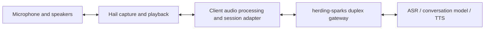

# Hail and duplex speech-service roadmap

This roadmap spans Hail and its prospective clients/services. The
[2026-11-19 capability assessment](inference-node-capabilities.md) inspected the
live `herding-sparks` node: its authenticated gateway and vLLM text streaming
exist, while ASR, TTS and a duplex session interface remain missing from the
inspected managed deployment. Speech runtime/model choices and audio protocols
still need to be established. Hail remains a bounded native PCM
transport, with no mandatory networking, speech, DSP, model runtime or Hull dependency.

## Intended system

Assume microphones and speakers are attached to client machines and
`herding-sparks` provides remote inference. A headless inference server does not
need Hail unless audio devices are attached to it.

The application must keep capturing while assistant audio plays. An ASR →
conversation model → TTS pipeline can support that continuous two-way transport;
it does not require a single speech-to-speech model. Model turn-taking and
transport duplex are distinct requirements.

| Component | Responsibility | Boundary |
| --- | --- | --- |
| Hail | Device discovery, exact application PCM contracts, capture/render queues, clock/gap metadata, render reference, playback flush/generations, safe lifecycle | No resampling, AEC, VAD, codec, network protocol, model or conversation scheduling |
| Client speech adapter | Explicit sample-rate/channel/sample-format conversion, framing, decoder state, AEC, VAD, network jitter/playout buffering, interruption orchestration | Application/service component above Hail; off native callbacks and UI/runtime owner threads |
| herding-sparks inference | Incremental ASR, streamed conversation output, incremental TTS, cancellation, bounded concurrency and resource scheduling | Verify actual model/runtime capabilities rather than inferring them from endpoint names |
| Duplex gateway | Authenticated sessions, declared formats, ordered events, response/turn IDs, flow control, cancellation, reconnect/error behavior | Separate service; may offer a precisely documented OpenAI-compatible subset |
| Optional Hull binding | Capability checks, quotas, bounded copies/events and externally owned native workers | Follow the architecture's ownership boundary; no native servicing/control on the language runtime thread |

See [architecture](architecture.md), [API ownership](api.md) and
[native backend contracts](native-backends.md) for Hail's existing obligations.
An adapter should first demonstrate a requirement the present API cannot meet
before proposing a public ABI change. Keep platform types and worker details private.

## Platform qualification

| Track | Next work and acceptance |
| --- | --- |
| macOS CoreAudio | Hosted functional CI now passes on arm64 macOS 15 and 26 for all sixteen format combinations per linkage, strict repetitions and ASan/UBSan at a declared 2,048-frame native period. Preserve the [512-frame failures and investigation](coreaudio-ci-regression.md); low-latency hosted continuity remains unqualified. Continue target-device/physical fixture coverage rather than inferring blanket production acceptance. |
| Native Windows | [Shure native execution](native-windows-physical-results.md) now covers the format/startup matrix, ten-minute duplex, lifecycle cycles, real USB loss/reopen and ASan after a capture-clock fix. Complete the remaining [goal](native-windows-goal.md) with the approved signed paired fixture; calibrate physical timing before making physical latency claims. |
| Native Linux clients | Qualify real physical devices on the intended client hardware. Existing PipeWire isolated-loopback and ALSA null evidence do not establish physical microphone/speaker support. |
| Cross-platform CI | All eleven jobs pass after using Intel for the general macOS lane and retaining arm64 native tests. Preserve the earlier runner-acquisition cancellations separately from source/test failures; exact [runs and profiles](coreaudio-ci-regression.md) are recorded. |

Across native clients, exercise capture/playback/duplex, primed startup, native
flush with capture progress, stale generations, stop/restart, repeated teardown,
permission denial, removal/reconnection, default pinning, unsupported formats,
clock resets, starvation and overflow. Use normal OS authorization and signed
fixture provisioning; do not weaken security or privacy controls.

Record at least ten minutes of sustained duplex per selected target, separating
startup/transitions from sustained xruns. Keep Release correctness/performance
separate from sanitizers and diagnostic instrumentation. Preserve source/binary
hashes, device/driver/transport, native periods, formats, queue capacities,
power/load configuration and every failure. Physical latency and audible tails
require an appropriate known/calibrated path; explicitly record its absence.

## Audio and model adaptation

Use devices at their negotiated supported rates. Hail currently does not change
physical nominal rates or resample the core transport. The speech adapter must
explicitly convert to/from each model or wire format and account for conversion
buffering and delay. The reference Whisper frontend uses 16 kHz mono audio;
this does not imply the client device should be forced to 16 kHz. See the
[Whisper frontend source](https://github.com/openai/whisper/blob/main/whisper/audio.py).

Keep device processing quantum independent from network packet/model-window
size. Repack bounded PCM into the negotiated transport framing. Declare sample
rate, channel count, representation, byte order and framing; raw PCM, WAV and
compressed audio are not interchangeable. Streaming codecs require persistent
decoder state and a declared interruption/reset policy.

A Whisper-compatible endpoint does not establish incremental ASR behavior.
Verify the selected runtime's chunking/windowing, partial versus final transcript
semantics, revisions, timestamps and latency. If it only accepts completed files,
provide a bounded incremental/endpointing layer or choose a runtime with suitable
streaming behavior. Preserve speech around VAD boundaries and interruptions.

Keep the serialized Hail control owner separate from PCM reader/writer servicing: native start/flush/teardown can block even though periodic authorization queries now run on a private worker. Schedule input processing independently from generation/playout. ASR must remain
serviced while the conversation model and TTS consume GPU resources. Bound
per-session queues and model concurrency, propagate cancellation to obsolete
work and measure under concurrent inference load. Avoid accumulating seconds of
speech behind a busy model or unbounded generated audio behind a slow client.

## API and session contract

OpenAI-compatible HTTP routes such as `/v1/audio/transcriptions`,
`/v1/audio/speech` and streamed chat responses do not, by themselves, establish a
continuous duplex session. Decide and document one of:

- A defined OpenAI Realtime-compatible subset with tested session/events,
  audio formats, cancellation and conversation truncation semantics.
- A project-owned persistent duplex gateway above compatible ASR/TTS/model
  endpoints. State explicitly which OpenAI SDK operations it supports and which
  session operations are project-specific.

A persistent WebSocket transport is a reasonable first native-client prototype;
evaluate WebRTC if its media transport/clock/jitter facilities are needed.
Do not label either choice compatible until an actual client conformance test
passes. [OpenAI's Realtime conversation documentation](https://developers.openai.com/api/docs/guides/realtime-conversations)
describes the bidirectional event and interruption behavior to compare against;
[file transcription](https://developers.openai.com/api/docs/guides/speech-to-text)
is a separate workflow from live incoming audio.

Define session, turn, response and audio-sequence identities; format negotiation;
partial/final transcript events; speech-start/end; output-audio chunks; error and
completion events; cancellation acknowledgements; and reconnection behavior.
Authenticate and encrypt the connection, keep credentials in their intended
trust boundary, and enforce explicit per-session memory/work limits. Socket
backpressure must not block a native audio callback.

Preserve source audio time/gaps across packetization and resampling, with an
explicit relation to model transcript time. Treat native capture/render clocks,
network clocks and server clocks as distinct until correlated. Discontinuities
must reset or invalidate dependent state rather than silently stretching history.

## Interruption and acoustic duplex

A successful interruption must preserve the user's ongoing capture:

1. Keep capture, input preprocessing and speech detection active during TTS playback.
2. Detect genuine user speech while rejecting the assistant's acoustic echo.
3. Locally stop/discard queued old playback promptly; do not wait for a remote
   cancellation round trip before initiating Hail's playback flush.
4. Cancel obsolete conversation/TTS work and reject late network chunks for the
   interrupted response. Clear adapter jitter buffers and decoder state according
   to the codec/session policy as well as flushing Hail's queue.
5. Retain the old Hail generation on old work so stale writes fail. Associate
   fresh response audio with the newly acknowledged generation; never relabel
   delayed old audio to make a write succeed.
6. Reconcile server conversation state with the portion played. Track the chosen
   playback estimate and uncertainty: Hail's render reference is submission
   selection, not proof of DAC presentation or an exact audible endpoint.
7. Continue consuming the beginning of the interrupting utterance and start the
   next response without replaying buffered content from the cancelled response.

The first integration milestone uses headphones to reduce acoustic echo. Open-
speaker support additionally needs an external AEC path fed from Hail's render
reference, with native delay, resampling delay, independent clock drift and
reference gaps/resets accounted for. Flush/reset can invalidate reference ranges;
do not pretend the reference is perfectly aligned hardware playback. Qualify
simultaneous user/assistant speech, not only alternating turns in a quiet room.
VAD/AEC/noise processing stay outside the Hail core.

## Delivery milestones and acceptance

1. **Extend native evidence.** Maintain the passing macOS functional CI profile
   and investigate low-latency hosted/physical fixture limits separately. Bring
   up the Windows rig and perform actual WASAPI capture/render/duplex qualification.
   Keep physical fixture gaps explicit.
2. **Establish node capabilities.** Initial live inspection is recorded in the
   [capability assessment](inference-node-capabilities.md): `qwen38-fp4` streams
   text; the existing gateway authenticates and bounds admission but exposes no
   speech/realtime routes. Next establish ASR/TTS services, authenticated client
   streaming, cancellation and mixed-workload capacity, then choose the wire
   contract from observed formats and incremental behavior.
3. **One headset conversation.** Build the native adapter plus gateway path.
   Continuously send input while streamed TTS plays. Demonstrate user interruption,
   capture continuity, cancellation propagation and rejection of late old audio.
4. **Acoustic duplex.** Add/qualify external AEC and VAD with speakers, differing
   device clocks, multiple output levels, background noise and simultaneous speech.
5. **Operational qualification.** Test jitter/stalls/disconnect/reconnect, model
   overload, GPU contention, client overload, permission/device changes, long
   conversations and multiple sessions. Verify bounded storage and quiescent exit.

Set product latency targets before acceptance. Report distributions for native
capture-to-consumer delivery, first partial/final ASR result, end-of-user-speech
to first response audio, speech-start to old-playback cessation, cancellation
acknowledgement, queue residence and xruns. Measure physical audible interruption
only with a suitable fixture and retain software-only estimates separately.
Token throughput alone does not establish a responsive duplex conversation.
