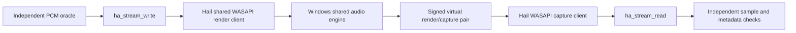

# WASAPI paired-endpoint loopback qualification design

Status: artifacts implemented; [paired-fixture execution](native-windows-paired-results.md)
failed the exact PCM oracle in all four 48 kHz stereo cases. Physical Shure
execution is recorded separately in [native results](native-windows-physical-results.md). See
[harness setup](wasapi-qualification.md) and [local results](native-windows-results.md).
Hail's shared WASAPI adapter builds and its
context/enumeration, portable suite and installed consumers pass Windows CI.
The headless runner in [run 43919570772](https://github.com/artalis-io/hail/actions/runs/43919570772)
returned no audio endpoints. It did not exercise native capture/render streams.
A successful build or empty enumeration is not native audio qualification.

The proposed test uses the existing public C API and the existing
[WASAPI adapter](../src/backend_wasapi.c). No public ABI, device-selector mode,
DSP component or production dependency is added. Provisioning stays outside
Hail, just as BlackHole installation stays outside the CoreAudio adapter.

## Fixture and routing

Use a disposable Windows VM with an independently installed, signed virtual
cable exposing one render endpoint and one capture endpoint. A candidate is
[VB-CABLE](https://vb-audio.com/Cable/): its documented routing forwards the
playback side to its recording side, and its installer requires administrative
installation and reboot. This is a fixture candidate, not an approved or
bundled Hail dependency. Its version, licensing/automation terms, package hash,
signature and reboot requirements must be established before provisioning.

The runner image must contain the functioning fixture before the test job starts.
A self-hosted disposable VM or suitable managed image is preferable to attempting
a reboot inside a GitHub-hosted job. Do not assume installation can complete
noninteractively or without reboot. Do not enable test-signing mode, disable
signature enforcement/Secure Boot, install an unsigned driver or alter microphone
privacy policy. Missing provisioning is a blocked qualification prerequisite,
not a passing or silently skipped test.

A provisioning manifest identifies both endpoint IDs, their directions, the
fixture's owning PnP instance, driver version/package hash and expected formats.
The test resolves these exact endpoints through Hail enumeration/persistent
keys and verifies their identities. It must never fall back to defaults, a
physical microphone, speakers or a different cable. Driver/device names alone
are insufficient. The same fixture must be reserved exclusively for the job.

## Why built-in WASAPI loopback is a separate test

[Microsoft's loopback mode](https://learn.microsoft.com/en-us/windows/win32/coreaudio/loopback-recording)
opens a capture client on an existing render endpoint using
AUDCLNT_STREAMFLAGS_LOOPBACK in shared mode. It does not create an endpoint on
an empty headless runner. Hail's current adapter opens capture clients on capture
endpoints and does not expose this render-monitor selector.

A native test helper could use Windows loopback to inspect Hail's render stream,
but that would qualify only Hail playback, not its capture client or full-duplex
path. Keep such a render-only diagnostic explicitly separate. The primary test
must send and receive PCM through Hail on the virtual cable's paired endpoints.
No loopback feature should be added to Hail merely to disguise absent hardware.

## Sample oracle and negotiation

The baseline is 48 kHz, stereo, interleaved PCM with fixed application quantum
256, bounded capture/playback/reference queues and explicit exact-application
negotiation. Test S16 and F32 separately. Record both negotiated application and
Windows engine formats, conversion flags and clock validity. Shared mode cannot
prove the physical format, so do not request or claim exact end-to-end behavior.

Choose a documented transparent fixture profile: matching endpoint/engine rates,
unity gains, no fixture effects, and no other audio clients. Use distinct channel
patterns, a frame counter/check sequence and generation markers. Samples should
be exactly representable at the fixture's documented precision. The independent
oracle checks sample values, channel mapping, ordering and generation transitions;
it must not reuse Hail queue/format helpers.

Bit-exact qualification requires a fixture path known to preserve those values.
If an OS/driver conversion profile is deliberately tested, define its expected
rounding/resampling oracle and numerical bounds before execution, report it as a
separate conversion case, and retain the actual format facts. Do not change
precision tolerances after a failed run, accept arbitrary PCM, or treat all-zero
capture as successful loopback. Each generation must deliver a minimum number
of verified nonzero frames, independently of silence frames.

## Test sequence and assertions

1. Create an explicit WASAPI context with a counting allocator and bounded
   memory/stream/device limits. Enumerate, validate the fixture manifest and
   probe both legs. Device access remains subject to normal Windows permissions.
2. Open a duplex stream. Prime playback before starting in the steady-state
   profile; retain a separate unprimed-start case to check counted silence.
   Poll start completion with an application-side deadline and print native
   diagnostic information on failure. A timeout fails the test and never
   authorizes freeing unretired native storage.
3. Play generation A while continuously draining capture and render reference.
   Verify known PCM and metadata. Record counters at the measured phase boundary
   so startup underruns are distinguishable from steady-state underruns.
4. Fill a bounded amount of queued playback, request native-required flush and
   continue capture. Verify acknowledgement/result and stale-write rejection.
   Observe generation B after acknowledgement; no generation A may follow the
   first verified B. Capture must continue while the render client is reset.
5. Stop, await completion, check old generations are stale, and restart with
   generation C. Validate new stream epochs and verified post-restart PCM.
6. Deliberately stop producing playback while continuing capture: require silence
   and observable underrun counts. Delay capture reads beyond queue capacity:
   require newest-drop loss accounting and subsequent gap/loss metadata. These
   injected faults are outside nominal latency/xrun measurements.
7. In a dedicated lifecycle case, disable only the manifest's virtual PnP device
   using the provisioner's normal administrative mechanism. Require endpoint-loss
   notification/refresh and terminal DEVICE_LOST. Close, re-enable, refresh and
   explicitly reopen. Persistent endpoint strings may recur; runtime incarnation
   IDs must be new. No silent migration or automatic retry is allowed.
8. Join application I/O roles before close_finish, progress native retirement,
   destroy the context and verify a balanced allocator ledger. No successful
   destruction may leave callbacks/COM workers referring to application storage.

The [current worker](../src/backend_wasapi.c) owns IAudioClient and its service
interfaces on a dedicated COM thread. Tests should stress pending start/stop/
flush/retire supersession and endpoint invalidation while processing; they must
not invoke COM service methods from a second test thread to manufacture races.
Use normal public Hail operations and controlled fixture changes.

## Clock, flush and real-time contracts

Independent capture/render endpoint clocks remain independently observable;
equal nominal rates do not establish synchronization. Capture device positions
are sample frames when valid. Render correlation is estimated; record its flags
and uncertainty rather than treating it as measured DAC presentation time.

Strict release trials require capture position/epoch continuity through a
render-only flush on the stable fixture. Instrumented/load trials may encounter
native discontinuities, but every accepted clock/sample gap must have matching
block/event metadata and remain in the report. Corrupt samples, channel swaps,
old-after-new generations or unmarked gaps remain failures. Keep this profile
separate from strict continuity; never retry until a clean-looking run appears.

Measure request-to-observed flush acknowledgement separately from the last old
sample observed at capture. The cable/engine may already contain old PCM after
Hail reset; captured-tail timing also includes capture buffering and is not an
audible-tail bound. A FIFO virtual path must never deliver old-generation data
after new-generation data. Capture progress must be independent of playback reset.

No Hail heap calls are permitted during processing/control progress after open;
count allocator calls. This does not certify Windows engine/driver allocations.
Native servicing never calls arbitrary application code. Record the application
polling interval and allow normal SDK calls to block on control/COM-owner threads.

## Proposed artifacts and CI

Implement a `hail_wasapi_loopback` C executable behind HA_BUILD_NATIVE_TESTS and
HA_BACKEND_WASAPI, plus a PowerShell fixture/manifest validator outside Hail.
Use QueryPerformanceCounter, Windows-aligned allocator hooks and the public
Hail interface; platform types stay in test code. Add a manually dispatched
workflow targeting a provisioned runner label such as `hail-wasapi-loopback`.
Do not label a hosted runner's empty-device run as this qualification job.

Run static/shared Debug/Release, C/C++ installed consumers, then dedicated
lifecycle/fault trials. Windows ClangCL AddressSanitizer needs a verified native
runtime/toolchain configuration; the current HA_SANITIZER option rejects MSVC
mode, so the Linux invocation is not portable unchanged. Application Verifier/
PageHeap and ETW are supplementary diagnostics. Windows TSan coverage is not
assumed. Keep allocation checks, SDK callback retirement and actual multithreaded
stress distinct from virtual scheduling tests.

Save machine/OS/driver image versions, source/executable hashes, signatures,
fixture identities, formats, native buffer sizes, all capacities, thread/power/
scheduling settings, trial duration, counts, raw logs and failures. Report
producer-to-capture delivery percentiles, observed flush acknowledgement and
captured-tail timing separately; add CPU, process memory and Hail byte budget.
Never present this software path as physical ADC/DAC latency.

## Execution gate

The design is ready for implementation once there is a provisionable, approved
signed fixture image with its endpoint/driver manifest. Stock hosted Windows CI
currently supplies no such pair. Driver automation/license acceptance and image
availability remain explicit decisions; no fixture is silently downloaded or
installed by this design. Until actual nonzero PCM and lifecycle trials pass,
WASAPI's status remains build/enumeration verified, native streaming unqualified.
